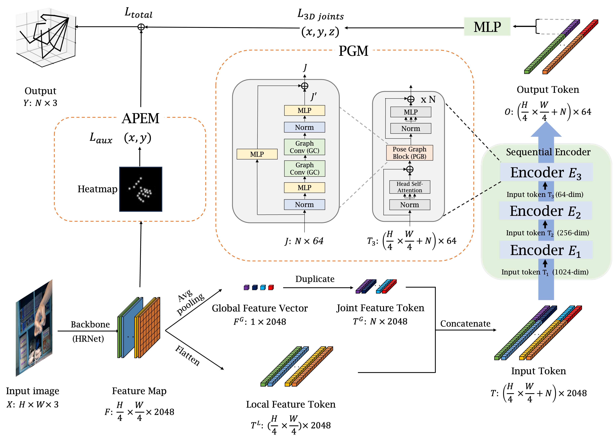
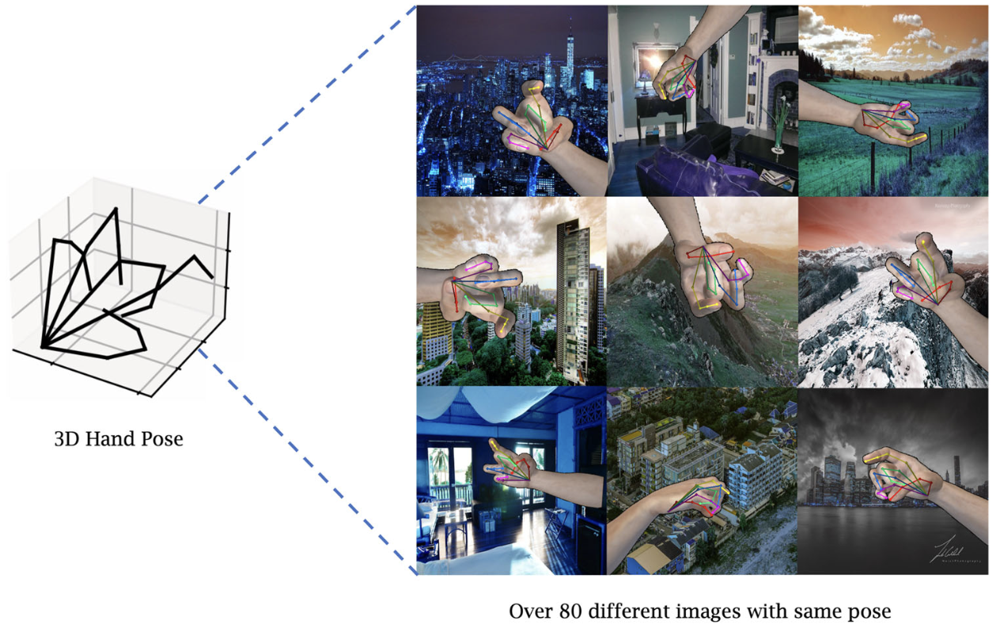
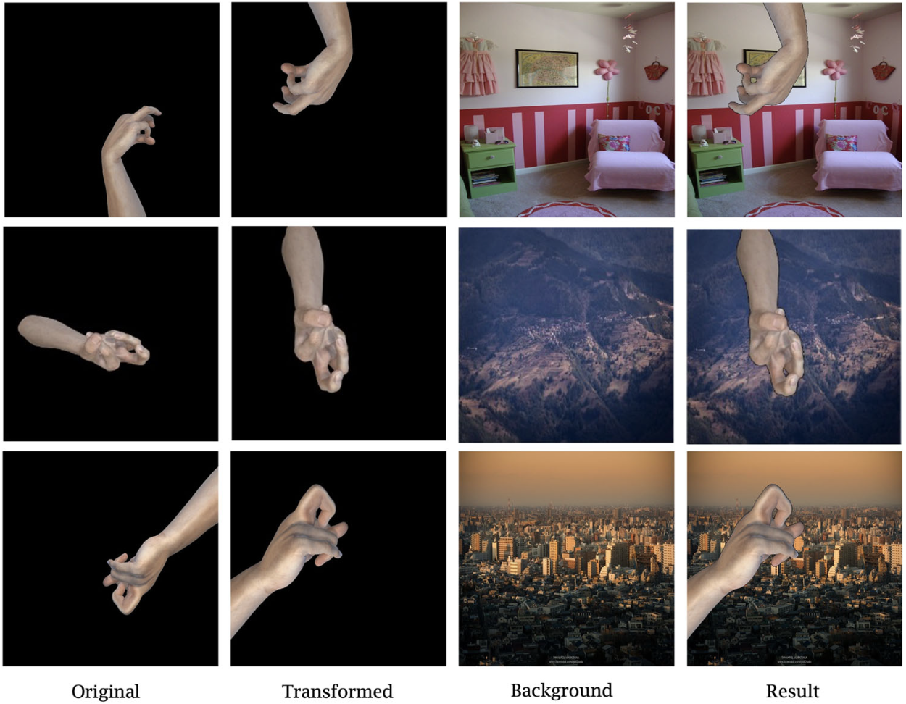

# Enhancing 3D Hand Pose Estimation Using SHaF
[](https://doi.org/10.1007/s10489-024-05665-x)

Code repository for the paper: **"Enhancing 3D hand pose estimation using SHaF: synthetic hand dataset including a forearm"**, published in *Applied Intelligence (APIN)*, 2024.

>**Authors:** Jeongho Lee¹, Jaeyun Kim¹, Seon Ho Kim², Sang-Il Choi¹<br>
¹ Dankook University, South Korea <br>
² University of Southern California, United States

---

## 🌟 Overview
We propose:

- **SHaF**: A synthetic hand image dataset including the **forearm**, generated with Unity.
- A transformer-based 3D hand pose estimation model (21 joints from a single RGB image) that **does not require 3D mesh** annotations, yet outperforms mesh-based SOTA methods.



---

## 📁 Directory Structure
```
{$ROOT}
|-- src
|   |-- tools        # entry points: train.py, frei_eval_3d.py (run commands from here)
|   |-- modeling     # Graphormer encoder, PGB graph block, HRNet backbone
|   |-- datasets     # FreiHAND TSV loader (from MeshGraphormer)
|   `-- utils        # training loop, losses, data loaders (SHaF / DART / GANerated / SynthHands)
|-- models           # backbone configs; ImageNet weights go here (not included, see below)
|-- datasets         # datasets go here (not included, see below)
`-- docs             # figures used in this README
```

---

## ⚙️ Installation

Tested with Python 3.9, PyTorch 2.1.0 (CUDA 12.1) on a single NVIDIA GPU. A GPU is required (the code calls `.cuda()`).

```bash
git clone https://github.com/leejeongho3214/SHaF.git
cd SHaF
conda env create -f environment.yml
conda activate shaf
```

or, with an existing Python 3.9 environment:

```bash
# install the PyTorch build matching your CUDA version first, e.g.
pip install torch==2.1.0 torchvision==0.16.0 --index-url https://download.pytorch.org/whl/cu121
pip install -r requirements.txt
```

`pytorch3d` is **only** needed for training on DARTset (it is used to read `hand_mesh.obj`). See the
[pytorch3d install guide](https://github.com/facebookresearch/pytorch3d/blob/main/INSTALL.md).

Notes:
- Use PyTorch < 2.6 or keep the `weights_only=False` arguments in the code: checkpoints contain non-tensor objects.
- Keep NumPy < 2 (`np.trapz` is used in the evaluation).

---

## 📦 Data preparation

All paths are **relative to `src/tools`**, i.e. the code expects `datasets/` and `models/` at the repository root.
Only the datasets you actually train on are needed. **MANO is not required**: the model regresses joints only
and no part of the training / evaluation code loads MANO (the `MANO_*` constants left in
`src/modeling/data/config.py` are unused leftovers from MeshGraphormer).

```
{$ROOT}
|-- models
|   |-- hrnet
|   |   |-- cls_hrnet_w64_sgd_lr5e-2_wd1e-4_bs32_x100.yaml   # included
|   |   `-- hrnetv2_w64_imagenet_pretrained.pth             # download (--backbone hrnet)
|   `-- simplebaseline
|       `-- imagenet
|           `-- resnet50-caffe.pth.tar                      # download (--backbone sbl)
`-- datasets
    |-- freihand                     # FreiHAND in MeshGraphormer/METRO TSV format
    |   |-- train.yaml  train.img.tsv  train.img.lineidx  train.hw.tsv  train.hw.lineidx
    |   |   train.label.tsv  train.label.lineidx  train.linelist.tsv  train.linelist.lineidx
    |   `-- test.yaml   test.img.tsv   test.img.lineidx   test.hw.tsv   test.hw.lineidx
    |       test.label.tsv   test.label.lineidx   test.linelist.tsv   test.linelist.lineidx
    |-- data_230710                  # SHaF
    |   |-- images/train/<camera_id>/image<frame>.png
    |   |-- background/*.jpg          # background images pasted behind the hands (required for SHaF and both/ runs)
    |   `-- annotations/train/anno_0.1M.pkl  (anno_20k.pkl, anno_50k.pkl)
    |-- DARTset                      # optional, run prefix dart/
    |   |-- train/  part_<k>.pkl, <k>/ (only listed to find the part names), <k>_wbg/ (images with background, read by the loader), <k>_verts/ (optional)
    |   `-- test/   same layout as train/
    |-- assets/hand_mesh.obj         # optional, needed by the DARTset loader only
    |-- GANeratedHands_Release/data/noObject/...   # optional, run prefix GAN/
    `-- SynthHands_Release/...                     # optional, run prefix SynthHands/
```

### Backbone ImageNet weights (third-party, not redistributed here)
- **HRNet-W64**: `hrnetv2_w64_imagenet_pretrained.pth` from
  [HRNet-Image-Classification](https://github.com/HRNet/HRNet-Image-Classification)
  (the MeshGraphormer `scripts/download_models.sh` script also downloads it). Put it in `models/hrnet/`.
  If the file is missing, training prints a warning and the backbone starts from random initialisation.
- **SimpleBaseline ResNet-50**: `resnet50-caffe.pth.tar` from the ImageNet models released with
  [human-pose-estimation.pytorch](https://github.com/microsoft/human-pose-estimation.pytorch).
  Put it in `models/simplebaseline/imagenet/`. It is required for `--backbone sbl`
  (training **and** evaluation, the model constructor raises an error otherwise).

### FreiHAND
Download the FreiHAND TSV files prepared by [MeshGraphormer](https://github.com/microsoft/MeshGraphormer)
(see its `docs/DOWNLOAD.md`) and place them in `datasets/freihand/`.
`train.yaml` is used for training and `test.yaml` (the 3,960-image FreiHAND evaluation set) for evaluation.

### SHaF
<a name="shaf"></a>
The SHaF dataset and the trained checkpoints are not distributed with this repository because of their size.
The expected layout is shown above.
Each entry of `anno_*.pkl` is a dict with `file_name`, `joint_2d` (21×2, pixels in the 800×800 render),
`camera_coor_3d` (21×3), `bbox`, `rot`, `scale` and a few other fields.
`src/tools/make_pkl.py` shows how the `anno_*.pkl` files were built from the raw Unity export
(`annotations/train/CISLAB_train_{camera,joint_3d,data}.json`); it is only needed if you regenerate them.
Use `--shaf_anno` to choose the subset (`anno_0.1M.pkl` by default, `anno_20k.pkl`, `anno_50k.pkl`).
The loader also needs `data_230710/background/*.jpg` (any folder of background JPEGs works; the paper experiments used
6,000 city-scene images).

### Other synthetic datasets (optional)
- DARTset: [DART](https://dart2022.github.io/). `assets/hand_mesh.obj` comes from the DART release.
- GANerated Hands: [GANerated Hands dataset](https://handtracker.mpi-inf.mpg.de/projects/GANeratedHands/GANeratedDataset.htm).
- SynthHands: [SynthHands dataset](https://handtracker.mpi-inf.mpg.de/projects/OccludedHands/SynthHands.htm).

---

## 🏋️ Training

Run from `src/tools`:

```bash
cd src/tools
python train.py <dataset_prefix>/<run_name> [flags]
```

The **first component of the run name selects the training data** (the `--dataset` flag is ignored):

| Prefix        | Training data                         | Validation data used for checkpoint selection |
|---------------|---------------------------------------|-----------------------------------------------|
| `frei/`       | FreiHAND (`train.yaml`)               | FreiHAND evaluation set (`test.yaml`)         |
| `both/`       | FreiHAND + SHaF                       | FreiHAND evaluation set (`test.yaml`)         |
| `dart/`       | DARTset train                         | DARTset test                                  |
| `GAN/`        | GANerated Hands (noObject)            | random 10 % split (seed 523)                  |
| `SynthHands/` | SynthHands                            | random 10 % split (seed 523)                  |
| anything else (e.g. `ours/`) | SHaF only              | random 10 % split (seed 523)                  |

Outputs go to `src/tools/output/<run_name>/` (`checkpoint-good/state_dict.bin`, `log.txt`, and `train_image/`,
`test_image/` with visualisations every 10 validation iterations, wiped at epoch 0) and TensorBoard logs to
`src/tools/tensorboard/<run_name>/`. The checkpoint with the lowest validation PA-MPJPE is kept and training stops after
`--count` epochs without improvement (or after `--epoch` epochs, default 100).
**If `output/<run_name>/checkpoint-good/state_dict.bin` exists, training resumes from it**, whatever the current flags
are; use a new run name or `--reset` when you change the configuration.

### Flags that map to the paper

| Paper component | Flag | Paper setting |
|-----------------|------|---------------|
| Backbone | `--backbone hrnet` (HRNet-W64) / `--backbone sbl` (SimpleBaseline ResNet-50) | HRNet |
| PGB (pose graph block, 21-joint skeleton graph conv) | `--which_gcn a,b,c` (which of the 3 encoders get it), `--graph_num k` (in the last k layers) | `--which_gcn 0,0,1 --graph_num 1` |
| No PGB | `--which_gcn 0,0,0` | |
| APEM (auxiliary 2D heatmap head) | `--loss_aux w` (weight of the heatmap MSE loss, `0` = off) | `--loss_aux 0.5` |
| Transformer blocks N (Table 3) | `--num_hidden_layers N` | `4` |
| Early stopping patience | `--count` | `10` |

⚠️ The argparse defaults (`--which_gcn "0, 0, 1" --graph_num 4 --loss_aux 0 --count 4`) are **not** the paper
configuration; always pass the flags explicitly. Batch size is `--batch_size` (default 32, used in the paper) and the maximum number
of epochs is `--epoch` (default 100). Fixed hyper-parameters (in `src/utils/pre_argparser.py`):
Adam, lr 1e-4 decayed ×0.1 every 25 epochs, dropout 0.1, 4 attention heads.

### Commands

```bash
# Ours (PGB + APEM, HRNet) on FreiHAND  -> Tables 3/5/6
python train.py frei/ours_hrnet --backbone hrnet --which_gcn 0,0,1 --graph_num 1 --loss_aux 0.5 --num_hidden_layers 4 --count 10

# Table 6 ablation (replace hrnet with sbl for the SimpleBaseline rows)
python train.py frei/base_hrnet --backbone hrnet --which_gcn 0,0,0 --loss_aux 0   --count 10   # Base
python train.py frei/pgb_hrnet  --backbone hrnet --which_gcn 0,0,1 --graph_num 1 --loss_aux 0 --count 10   # PGB
python train.py frei/apem_hrnet --backbone hrnet --which_gcn 0,0,0 --loss_aux 0.5 --count 10   # APEM

# Table 3: number of transformer blocks N = 1..4
python train.py frei/ours_h1 --backbone hrnet --which_gcn 0,0,1 --graph_num 1 --loss_aux 0.5 --num_hidden_layers 1 --count 10

# Table 1: FreiHAND + SHaF
python train.py both/ours_hrnet --backbone hrnet --which_gcn 0,0,1 --graph_num 1 --loss_aux 0.5 --count 10 --shaf_anno anno_0.1M.pkl

# Table 1: synthetic data only (evaluated on FreiHAND)
python train.py ours/shaf       <arch flags> --count 10
python train.py dart/dart       <arch flags> --count 10
python train.py GAN/ganerated   <arch flags> --count 10
python train.py SynthHands/sh   <arch flags> --count 10
```

---

## 📊 Evaluation

All models are evaluated on the FreiHAND evaluation set (3,960 images, `datasets/freihand/test.yaml`).
Pass the **same run name and architecture flags** that were used for training:

```bash
cd src/tools
python frei_eval_3d.py frei/ours_hrnet --backbone hrnet --which_gcn 0,0,1 --graph_num 1 --num_hidden_layers 4
```

It prints PA-MPJPE (in **cm**; ×10 for mm) and the AUC of the 3D PCK curve over 0–5 cm, and appends both to
`src/tools/general_scores.txt`. The checkpoint is loaded with `strict=True`, so wrong architecture flags raise an
error instead of silently evaluating a partly random model.

Select the GPU with `CUDA_VISIBLE_DEVICES`, e.g. `CUDA_VISIBLE_DEVICES=0 python frei_eval_3d.py ...`.

---

## 📈 Results

### 📐 Evaluation Metrics
- PA-MPJPE (mm)
- AUC (PCK-based, 0–50 mm)

### 🧪 Quantitative Results

### Table 1: Performance Comparison on Different Training Datasets

| Dataset               | Backbone         | PA-MPJPE (mm) ↓ |
|-----------------------|------------------|-----------------|
| GANerated Hands [33]  | -                | 24.7            |
| Synthetic Hands [34]  | -                | 31.4            |
| DART [30]             | HRNet [15]       | 23.1            |
| **SHaF only (Ours)**  | HRNet [15]       | **21.3**        |
| FreiHAND              | SimpleBaseline   | 5.6             |
| **FreiHAND + Ours**   | SimpleBaseline   | **5.5**         |
| FreiHAND              | HRNet [15]       | 5.3             |
| **FreiHAND + Ours**   | HRNet [15]       | **5.2**         |

---

### Table 2: Effect of Forearm in Dataset

| SHaF Dataset     | PA-MPJPE (mm) ↓ |
|------------------|-----------------|
| w/o. forearm     | 22.1            |
| **w/. forearm**  | **21.3**        |

The preprocessing that removes the forearm from the SHaF images (the "w/o. forearm" row) is not included in this release.

---

### Table 3: Effect of Number of Transformer Blocks

| Identical Blocks (N) | AUC ↑   | PA-MPJPE (mm) ↓ |
|----------------------|--------|-----------------|
| 1                    | 0.888  | 5.64            |
| 2                    | 0.892  | 5.4             |
| 3                    | 0.894  | 5.31            |
| 4                    | 0.895  | **5.28**        |

---

### Table 4: Inference Speed Comparison (FreiHAND)

| Model             | PA-MPJPE (mm) ↓ | Speed (fps) ↑ |
|------------------|------------------|---------------|
| MeshGraphormer   | 5.9              | 12.5          |
| **Ours**         | **5.2**          | **23.31**     |

---

### Table 5: SOTA Comparison on FreiHAND

| Model               | Backbone    | Mesh Needed | PA-MPJPE (mm) ↓ |
|---------------------|-------------|-------------|-----------------|
| RHD [31]            | ResNet50    | ✗           | -               |
| FreiHAND [25]       | ResNet50    | ✓           | 11.0            |
| YoutubeHand [36]    | ResNet50    | ✓           | 8.4             |
| I2L-MeshNet [37]    | ResNet50    | ✓           | 7.4             |
| HIU-DMTL [26]       | -           | ✓           | 7.1             |
| CMR [55]            | ResNet50    | ✓           | 6.9             |
| I2UV-HandNet [56]   | ResNet50    | ✓           | 6.7             |
| METRO [18]          | HRNet       | ✓           | 6.7             |
| Tang et al. [57]    | ResNet50    | ✓           | 6.7             |
| MeshGraphormer [17] | HRNet       | ✓           | 5.9             |
| **Ours**            | HRNet       | ✗           | **5.2**         |

---

### Table 6: Ablation Study of APEM and PGB Modules

| Backbone       | Method        | PA-MPJPE (mm) ↓ |
|----------------|---------------|-----------------|
| SimpleBaseline | Base          | 5.88            |
|                | PGB           | 5.80            |
|                | APEM          | 5.78            |
|                | PGB+APEM      | **5.61**        |
| HRNet          | Base          | 5.36            |
|                | PGB           | 5.29            |
|                | APEM          | 5.30            |
|                | PGB+APEM      | **5.27**        |

### Notes on reproducing these numbers
- For `frei/` and `both/` runs the best checkpoint and early stopping are chosen by PA-MPJPE on the FreiHAND
  evaluation set (`test.yaml`), the same set used for the reported numbers. This is how the paper experiments were run.
- With this release, the FreiHAND HRNet PGB+APEM N=4 checkpoint from the paper experiments evaluates to
  PA-MPJPE 5.28 mm / AUC 0.895 (Table 3, N=4), identical to the paper.

---

## 📸 SHaF Dataset Characteristics

- 9,000 poses × 82 camera presets = **738,000 synthetic RGB images**
- **Forearm included** to reflect real-world scenes
- Biomechanically valid joint ranges
- t-SNE shows **uniform pose distribution**
- **Data augmentation** with backgrounds and transformations
<p align="center">
  
  
</p>

---

## 🔧 Model Design Highlights

- **Pose Graph Block (PGB)**: graph convolution over the 21-joint hand skeleton inside the transformer encoder
- **Auxiliary Pose Estimation Module (APEM)**: auxiliary 2D heatmap supervision on the backbone features, which improves gradient flow
- No 3D mesh needed → **lightweight & accurate** model

---

## 📖 Citation

```bibtex
@article{lee2024shaf,
  author    = {Lee, Jeongho and Kim, Jaeyun and Kim, Seon Ho and Choi, Sang-Il},
  title     = {Enhancing 3D hand pose estimation using SHaF: synthetic hand dataset including a forearm},
  journal   = {Applied Intelligence},
  year      = {2024},
  volume    = {54},
  number    = {20},
  pages     = {9565--9578},
  doi       = {10.1007/s10489-024-05665-x}
}
```

---

## 🙏 Acknowledgements

This code builds on:
[MeshGraphormer](https://github.com/microsoft/MeshGraphormer) and [METRO](https://github.com/microsoft/MeshTransformer) (transformer encoder, graph convolution, FreiHAND TSV loader),
[HRNet](https://github.com/HRNet/HRNet-Image-Classification) (backbone),
[SimpleBaseline](https://github.com/microsoft/human-pose-estimation.pytorch) (backbone),
[HuggingFace Transformers](https://github.com/huggingface/transformers) (BERT modules),
[GraphCMR](https://github.com/nkolot/GraphCMR), [Pose2Mesh](https://github.com/hongsukchoi/Pose2Mesh_RELEASE),
[InterHand2.6M](https://github.com/facebookresearch/InterHand2.6M), [maskrcnn-benchmark](https://github.com/facebookresearch/maskrcnn-benchmark)
and the [DART](https://dart2022.github.io/), [FreiHAND](https://lmb.informatik.uni-freiburg.de/projects/freihand/),
GANerated Hands and SynthHands datasets.
See [THIRD_PARTY_NOTICES.md](THIRD_PARTY_NOTICES.md) for the licences of the bundled third-party code.

---

## 📄 License

This code is released under the [MIT License](LICENSE). Bundled third-party code keeps its original licence (see [THIRD_PARTY_NOTICES.md](THIRD_PARTY_NOTICES.md)).

## 📧 Contact

> Ph.D. Program, Department of Computer Science
> Dankook University, South Korea
> **Jeongho Lee** · 📧 [72210297@dankook.ac.kr](mailto:72210297@dankook.ac.kr)
